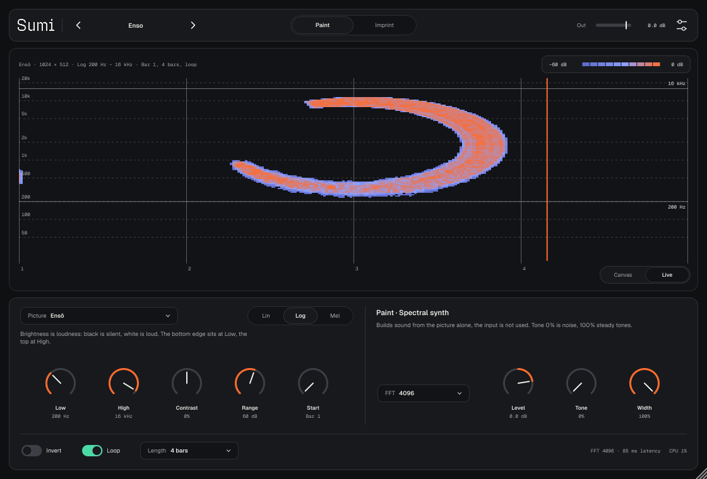
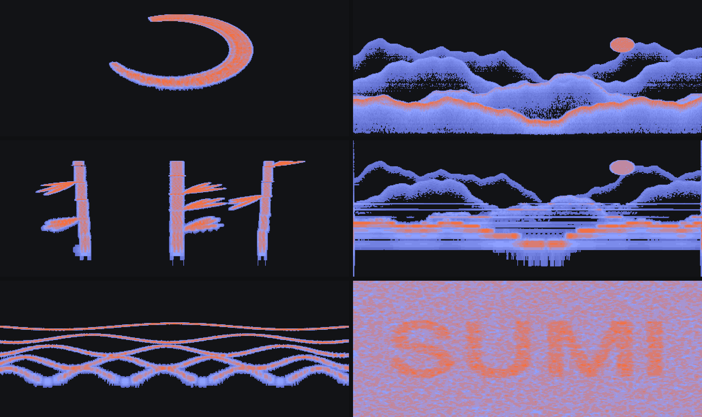
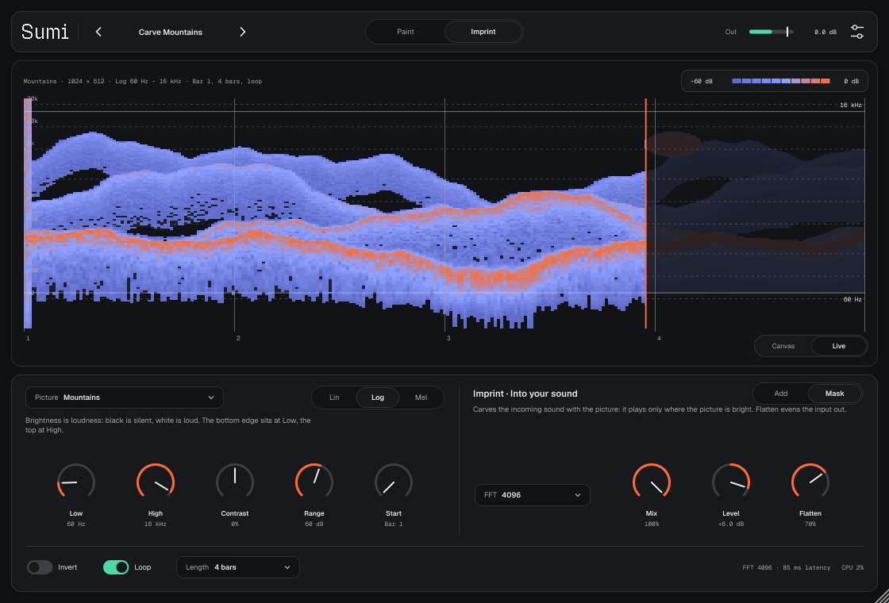
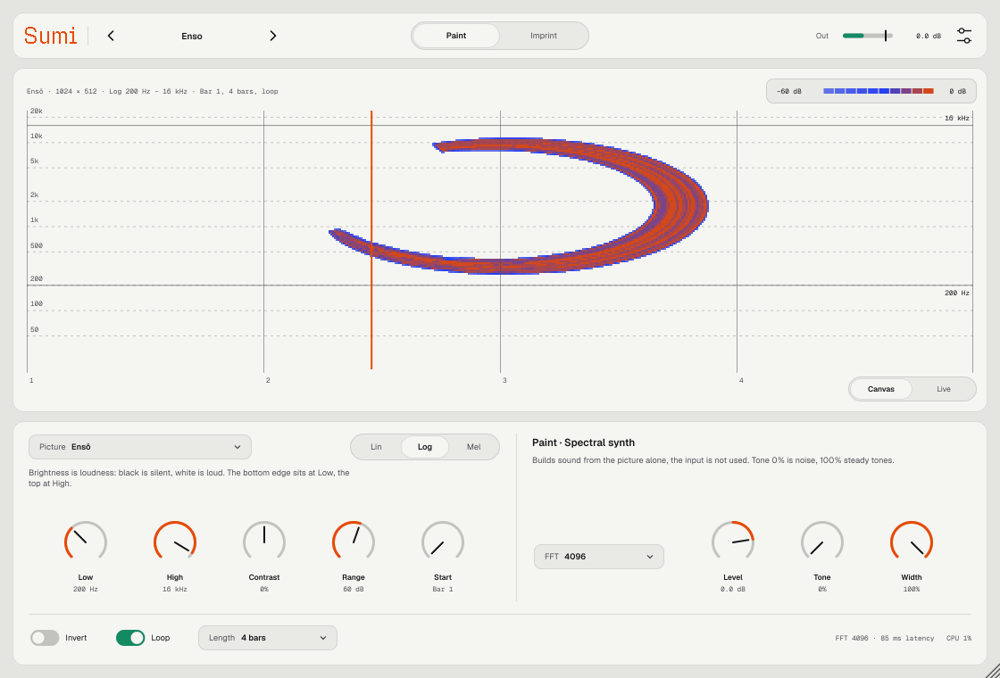

<p align="center">
  
</p>

<p align="center">
  
  
  
  
</p>

<p align="center">
  <a href="https://github.com/controloptioncommand/Sumi-vst/releases/latest/download/Sumi-macOS.zip"><b>⬇ Скачать Sumi для macOS</b></a>
</p>

---

**Sumi** (墨, японская тушь) — вайбкод-плагин, который рисует картинку на спектрограмме. Яркость пикселя становится громкостью, высота — частотой, ширина — временем. Откройте результат в любом анализаторе спектра, и там будет картинка.

Брат [Mist](https://github.com/controloptioncommand/Mist-vst), [Eido](https://github.com/controloptioncommand/Eido-vst) и [Talk2Me](https://github.com/controloptioncommand/Talk2me): те же темы Oxygen и Rubber, шрифты Medeo и страница About.

## Два режима

| Режим | Что делает |
|---|---|
| **Paint** | Синтез с нуля, главное — картинка, а не звук. Каждый кадр спектра строится из столбца картинки, вход не нужен. **Tone** — от шума (картинка самая чёткая) к ровным тонам (звучит как орган), **Width** — стерео. |
| **Imprint** | Картинка вписывается в готовый звук. **Add** кладёт её поверх, исходник не меняется. **Mask** вырезает звук по форме картинки: он остаётся только там, где картинка светлая. **Flatten** выравнивает спектр входа, чтобы картинка проступала и там, где у звука мало энергии. **Mix** — сухой и обработанный. |

<p align="center">
  
</p>
<p align="center"><sub>Спектрограммы демо из архива релиза: Enso, Misty Mountains, Bamboo Organ, Carve Mountains (Mask по аккорду), Sliding Tones, Hidden Signature (Add, 15–19.5 кГц).</sub></p>

## Картинка

- **Picture** — загрузить PNG, JPG или GIF (или просто перетащить файл на вид), набрать текст (**Type text…**) или выбрать встроенную: Ensō, Sumi, Mountains, Bamboo, Rain, Waves, Test Card. Картинка сохраняется в проекте и в пресете.
- Чёрное звучит тишиной, белое — громче всего. Для тёмного рисунка на белом фоне включите **Invert**.
- **Low** и **High** — между какими частотами лежит картинка: низ картинки — Low, верх — High.
- **Lin / Log / Mel** — шкала частот. Ставьте ту же, что у анализатора, в котором будете смотреть: Lin — Spek, Audacity и большинство онлайн-спектрограмм, Log — iZotope RX, SPAN и Pro-Q, Mel — анализаторы речи и машинного обучения. Иначе картинка растянется по высоте.
- **Contrast** — гамма яркости (средние тона тише или громче), **Range** — сколько децибел между белым и самым тёмным серым.

## Время

Картинка стоит на тактах DAW и играет по транспорту. **Start** — такт начала, **Length** — длина от 1/2 до 64 тактов, **Loop** — повтор. Задержка плагина (размер FFT) сообщается хосту, и он её компенсирует, поэтому картинка точно попадает на свой такт и в экспорте. Без транспорта (Standalone) картинка идёт по кругу.

**FFT 1024–8192** — компромисс резкости: маленький FFT — чёткие края по времени, большой — по частоте (и больше задержка: 4096 при 48 кГц — 85 мс).

## Главный вид

**Canvas** показывает картинку так, как она ляжет на спектрограмму: в выбранной шкале, с полосой Low–High, тактами и курсором воспроизведения. **Live** показывает спектрограмму выхода. Колонки пишутся под курсором поверх бледного следа картинки, поэтому сразу видно, как картинка проступает в звуке.

<p align="center">
  
</p>

## Пресеты

12 фабричных. Paint: Enso, Ink Wordmark, Misty Mountains, Bamboo Organ, Rain on Glass, Sliding Tones, Test Card. Imprint: Carve Mountains, Enso Stencil, Hidden Signature, Rain Layer, Half Mask. Пресет хранит картинку и настройки. Свои пресеты сохраняются через меню пресета → Save preset, лежат в `~/Music/Sumi/Presets/*.sumi`.

## Две темы

**Oxygen** — светлая, **Rubber** — тёмная, или по системе: иконка настроек → Appearance. Там же размер окна.

<p align="center">
  
</p>

## Установка

1. Скачайте **[Sumi-macOS.zip](https://github.com/controloptioncommand/Sumi-vst/releases/latest/download/Sumi-macOS.zip)** и распакуйте.
2. В Терминале:
   ```bash
   bash ~/Downloads/Sumi-macOS/install-mac.sh
   ```
   Скрипт кладёт `Sumi.vst3` и `Sumi.component` в `~/Library/Audio/Plug-Ins` и снимает карантин macOS: плагин подписан ad-hoc, без сертификата Apple.
3. Перезапустите Ableton или Settings → Plug-Ins → Rescan. Sumi — аудиоэффект: для Paint ставьте его на пустую аудиодорожку, для Imprint — на дорожку со звуком.

В архиве есть папка `demo` с примерами звучания и их спектрограммами. Подробное руководство — **[Sumi-manual.pdf](docs/Sumi-manual.pdf)**, оно же лежит в архиве релиза.

Нужен Mac с macOS 11 или новее (Apple Silicon или Intel). Каждое изменение в `main` автоматически собирается, проходит pluginval и auval и выкладывается в [Releases](https://github.com/controloptioncommand/Sumi-vst/releases).

## Сборка

```bash
cmake -B build -DSUMI_BUILD_TESTS=ON && cmake --build build --config Release --target Sumi_VST3 Sumi_AU SumiTest
./build/SumiTest_artefacts/Release/SumiTest ./render
```

JUCE 8 скачивается автоматически.

Тест проверяет таблицу сумм картинки и шкалы частот, прозрачность STFT, линию на нужной частоте и главное — что картинка видна: строит спектрограмму выхода и сравнивает её с картинкой (корреляция 0.74–0.95). Ещё он проверяет привязку к тактам с учётом задержки, Mask, Add и Mix, крайние значения, состояние, все пресеты и скорость, пишет демо-WAV со спектрограммами и снимает скриншоты.

Руководство в PDF собирается из `docs/manual/Sumi-manual.html` (нужны Python 3 с Pillow и Node.js с Playwright):

```bash
bash docs/manual/build.sh
```

## Устройство

| Где | Что |
|---|---|
| `Source/Picture.*` | Картинка: яркость, таблица сумм для среднего по любому прямоугольнику, встроенные картинки, текст, PNG в состоянии |
| `Source/DSP/FreqMap.h` | Шкалы Lin / Log / Mel |
| `Source/DSP/SpectralEngine.*` | STFT (Hann, 75%), Paint, Imprint: Add, Mask, Flatten |
| `Source/PluginProcessor.*` | Транспорт DAW → положение в картинке, состояние, выход с лимитером |
| `Source/UI/` | Интерфейс, темы Oxygen / Rubber, Canvas и Live, About |

Написан на C++ и [JUCE 8](https://juce.com). Чужой код и данные — в [THIRD_PARTY.md](THIRD_PARTY.md).

<p align="center"><sub>made by nnn · vibe-coded with Claude</sub></p>
